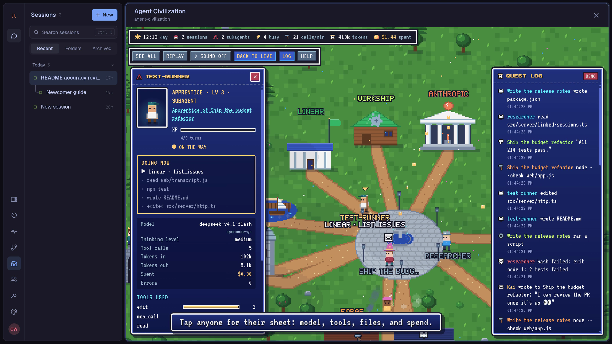
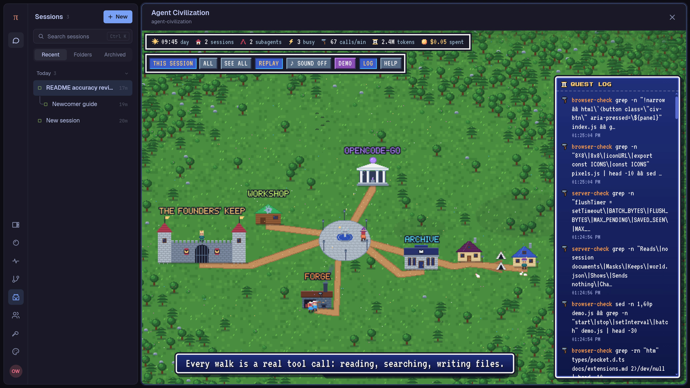

# Agent Civilization for Pi Pocket

Every agent at work, as a living retro pixel-art town. Sessions are wizards with houses, subagents are
apprentices camped in tents beside them, and linked sessions are envoys down the road. Each tool call is
a walk to a building, models are oracle temples that pay out coins, and messages fly by pigeon.



**[Watch the demo (under 2 minutes, 2560×1440)](https://github.com/TannerMidd/pi-pocket-agent-civilization/releases/download/v1.0.0/agent-civilization-demo.mp4):**
a real task (Pi, two subagents, and a linked session review this extension's README: 3 minutes and
5 cents of real work), replayed from its own events, then the busy demo town.



Version **1.0.0** needs **Pi Pocket 0.19.0** or later (extension API **2**). It needs no network, no
outside service, no model calls of its own, and no setting.

## Install

**From the gallery:** Menu → Extensions → **Discover**, select **Agent Civilization**, read its files,
and install it. It installs off: turn it on in Menu → **Extensions**.

**By hand:** copy these into the `extensions/` folder of Pi Pocket's data folder (by default
`~/.pi-pocket/extensions/`), then turn it on in Menu → Extensions:

```text
extensions/
  agent-civilization.ts
  agent-civilization/
    index.js  town.js  pixels.js  demo.js  sound.js  style.css
    fonts/    CivPixelStart.woff2  VT323.woff2  OFL-PressStart2P.txt  OFL-VT323.txt
```

Do not copy `test/`, `docs/`, `package.json`, or `_pocket.d.ts`.

## Use

Open **Civilization** in the rail (or "Open Agent Civilization" in the launcher, Ctrl+K / ⌘K). Press
**Demo** to see a busy fake town with no agents running.

- **This session / All:** the session you came from with its family, or every session you can see.
- **See all:** the whole town in view. Drag to pan; scroll or pinch to zoom.
- **Tap anyone** for their character sheet: what they do now, model, thinking level, tool calls,
  tokens, spend, errors, the tools they used, the files they touched, and their team.
- **Replay:** the day again as a time-lapse. **Log:** the quest log. **Help:** the manual.

### What you see

| In the town                           | In Pi Pocket                                                                |
| ------------------------------------- | --------------------------------------------------------------------------- |
| A wizard and their house              | A session; the sign over the house is its title                             |
| An apprentice and their tent          | A subagent, by its parent's house                                           |
| An envoy's house down the road        | A linked session, on a road from the session that started it                |
| The Founders' Keep                    | The people who write to the agents, on its wall                             |
| Oracle Temple (one for each provider) | Model requests: sparks while an agent thinks, coins (tokens) back           |
| Archive                               | `read`, `write`, `edit`                                                     |
| Forge                                 | Shell commands                                                              |
| Git Harbor                            | `git`, `gh`, PR watches; a `git push` sails a ship out                      |
| Observatory                           | The browser, and tools with "search", "fetch", or "web" in their names      |
| Workshop                              | Codemode scripts                                                            |
| Memory Vault                          | The memory tool                                                             |
| Gallery                               | Artifacts                                                                   |
| Clock Tower                           | Scheduled messages                                                          |
| Embassy (one for each MCP server)     | MCP calls, under that server's flag                                         |
| Guild Hall                            | Any other tool, from extensions                                             |
| A pigeon with a letter / a scroll     | A message, a subagent's task, or its report                                 |
| ✓ / skull over a head                 | A tool call that worked / failed                                            |
| A storm                               | 3 or more failed tool calls in the last 45 seconds, and a high failure rate |

A day lasts 8 minutes. Windows, lanterns, and campfires light up at night. Names and signs use a 5×7
pixel font with Latin letters only: other scripts show as `?`. With "reduce motion" on in your system,
there are no flashes, rain, glides, or typing.

## What it reads, keeps, and sends

- **Reads**, through its hooks, every tool call and model request in **every** session: the tool's name
  and its arguments, the model, token counts and cost, the start of each message and answer, the end of
  the model's reasoning, and the text of failed tool calls and model errors, all cut short. It reads no
  files, settings, sign-ins, or environment variables, and no session documents.
- **Masks** what looks like a secret before it keeps any text: API keys and tokens (`sk-…`, `ghp_…`,
  `Bearer …`, and others), `NAME=value` settings whose name says key, token, secret, or password, and
  private keys. Masking is a best effort: a secret in another form can still be kept.
- **Shows** what it reads only to the owner (its routes and page are owner-only), and only for sessions
  that Pi Pocket confirms the owner may see, through its `conversationRoute`, or subagents that such a
  session's own tool call started. Other people's sessions, such as their PiP, never show. The page does
  learn the ids of sessions not yet confirmed, so it can ask Pi Pocket about them, and nothing else.
- **Keeps** the last 3000 events and some counts in memory, and saves the last 1500 events every few
  seconds to `<data folder>/agent-civilization/world.json` (file mode 0600). For confirmed sessions
  that includes the words above, cut short and masked. For a session not yet confirmed, the file keeps
  no words, paths, titles, or names: only counts, tool and model names, and which sessions wrote to
  which. **Help → Forget all history** clears it all. After you uninstall it, delete the
  `agent-civilization` folder in the data folder too.
- **Sends** nothing over the network. It sends the town only to the owner's open Pi Pocket tabs
  (`web.send`). Its fonts and sounds are in its own files. In the browser it keeps a few view choices in
  `localStorage`, under `x.agent-civilization.*`.
- **Changes** nothing: each hook only records, catches its own errors, returns `undefined`, and never
  waits.

### What can change under it

Some of what it reads is internal to Pi Pocket and can change in any release: the arguments and results
of the built-in tools (`subagent`, `team`, `browser`, `mcp_*`, and the others), and the markers Pi Pocket
puts on messages (`[from: …]`, `[subagent …]`, `[scheduled]`, `[via PR watch]`, and the linked-session
wrapper). If one changes, the town fails soft: it loses a link, a label, or a building, never a call. The
tests pin what Pi Pocket 0.19.0 sends. The page also fills the app's page area through the app's
`.ext-page-body` class; if that changes, the town gets a thin frame.

### State

The town is a display cache derived from the sessions, which stay the source of truth in Pi Durable.
Hooks get no document commit, and a memo for each call of each session would grow every session's
history. So the town keeps its own world: in memory, handed on whole when the module's file is edited,
and in `world.json` across restarts, in its own data folder. Each hook keys what it counts by its task
and call (kept in the file too), so a hook that runs again after a restart counts nothing twice. If the
file is lost, only the town's history goes.

## What it installs

| What                                                                              | Why                                                                                                                         |
| --------------------------------------------------------------------------------- | --------------------------------------------------------------------------------------------------------------------------- |
| Hooks `beforeTool`, `afterTool`                                                   | Each tool call: a walk to its building, and its result                                                                      |
| Hooks `beforeRequest`, `afterResponse`                                            | Each model request: thinking, tokens, cost, new messages, and who sent them                                                 |
| Hook `onYield`                                                                    | An agent's turn ends: it goes home, and a subagent's report flies to its parent                                             |
| Route `GET world`                                                                 | The town as it is now, for a page that opens                                                                                |
| Route `GET meta/:source` (a `conversationRoute`)                                  | Pi Pocket confirms the owner may see a session: its title and model. It then counts as confirmed in the module's own memory |
| Route `POST reset`                                                                | Forget all                                                                                                                  |
| Browser module (owner), with a rail button, a launcher action, and the page `civ` | The town itself                                                                                                             |

No tools, prompt sections, wraps, or commands.

## How it is built

**Server (`agent-civilization.ts`).** The hooks turn what they see into small events (`tool`, `done`,
`think`, `reply`, `msg`, `link`, `idle`) and running counts per session and per place. Events go to open
pages in numbered batches every 250 ms (`web.send`), each well under the app's limit for one event, and
at most about 200 KB a flush; a page that misses a batch loads the world again. The world is capped
(events, sessions, places, visitors, people, waiting messages), saved with a write-then-rename by one
chain of saves for every version of the module, and handed from one version to the next through
`globalThis` when the file is edited, so a reload loses nothing. Records keyed by text from outside have
no prototype.

**Browser (`agent-civilization/`).**

- `index.js`: the page (Preact + htm from Pi Pocket): status bar, menu, quest log, character sheets,
  manual, and splash. It loads the snapshot, listens for batches, and reloads when the server restarts.
- `town.js`: the engine. It lays the town out to fit the view's shape, walks citizens along roads, and
  draws a low-resolution frame scaled up by a whole number, with words in a layer of their own so they
  read well at any zoom. Day and night, weather, the replay, and picking by tap.
- `pixels.js`: the palette, a 5×7 bitmap font, 8×8 icons, and the sprites.
- `demo.js`: a plausible fake town, in the server's event format.
- `sound.js`: chiptune music and effects made with Web Audio; no sound files. Off until you turn it on.
- `style.css` and `fonts/`: the windows, buttons, and phone layout, in Civ Pixel Start (Press Start 2P, renamed) and VT323 (WOFF2,
  the only font type Pi Pocket serves to extensions).

## Develop

The checks use Pi Pocket's packages. With a Pi Pocket checkout beside this folder:

```sh
ln -s ../pi-pocket/node_modules node_modules
npm run check    # TypeScript
npm test         # the server module: hooks, privacy, saving, batches, replays, Pi Pocket's formats
```

`_pocket.d.ts` is a copy of `types/pocket.d.ts` from Pi Pocket v0.19.0, for types only.

## License

The code is under the [MIT License](LICENSE). The fonts are under the SIL Open Font License 1.1, from
[google/fonts](https://github.com/google/fonts), converted to WOFF2 (the only font type Pi Pocket serves
to extensions), with their glyphs unchanged:

- **Civ Pixel Start** (`CivPixelStart.woff2`) is Press Start 2P 3.000 (`ofl/pressstart2p`), © 2012 The Press
  Start 2P Project Authors, under [its license](agent-civilization/fonts/OFL-PressStart2P.txt). "Press
  Start 2P" is a Reserved Font Name, and a change of format makes a Modified Version, so this one has a
  name of its own; its copyright notice is unchanged. [`scripts/rename-font.py`](scripts/rename-font.py)
  makes it.
- **VT323** (`VT323.woff2`) is VT323 2.000 (`ofl/vt323`), © 2011 The VT323 Project Authors, under
  [its license](agent-civilization/fonts/OFL-VT323.txt). It has no Reserved Font Name.
